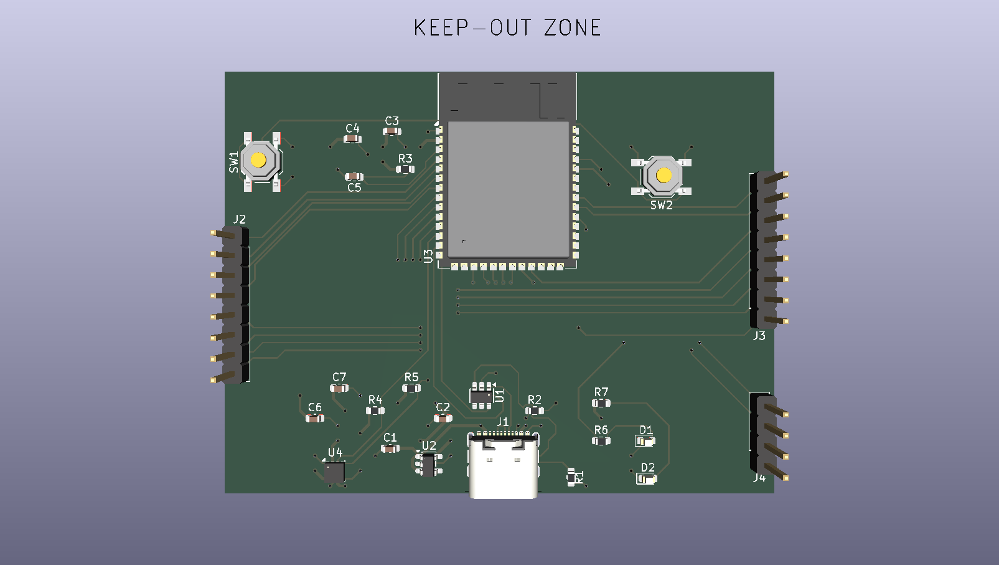

# ESP32-S3 USB Sensor Board

A 4-layer ESP32-S3 USB sensor board designed in KiCad 10 as a PCB design learning project.

## Features
- ESP32-S3-WROOM-1 with native USB
- USB-C input with USBLC6-2SC6 ESD protection and 5.1k CC resistors
- AP2112K-3.3 LDO (5V to 3.3V)
- BME280 temperature/humidity/pressure sensor (I2C)
- Reset and BOOT buttons, user LED and power LED
- Breakout headers for IO and UART

## Design details
- 4-layer stackup: F.Cu (signals), In1.Cu (GND plane), In2.Cu (3V3 plane), B.Cu (signals)
- USB D+/D- routed as a short pair, no vias
- Net classes for power and USB
- Antenna keep-out zone
- ERC clean, DRC clean (0 errors)

## Design check
.png)

## Status
Design only. This board has not been fabricated or tested.

## Files
- `new4layer.kicad_pro`, `new4layer.kicad_sch`, `new4layer.kicad_pcb`: KiCad project
- `new4layer.pdf`: Schematic
- `new4layer-F_Cu.pdf`, `new4layer-In1_Cu.pdf`, `new4layer-In2_Cu.pdf`, `new4layer-B_Cu.pdf`, `new4layer-Edge_Cuts.pdf`, `new4layer-F_Silkscreen.pdf`: PCB layers
- `new4layer3d.png`: 3D render

## What I learned
- Why inner GND and 3V3 planes matter for return paths and noise
- Placement decides routing, so moving one part can save many tracks
- How to handle library footprint constraints while keeping a clean DRC

## Tools
KiCad 10
